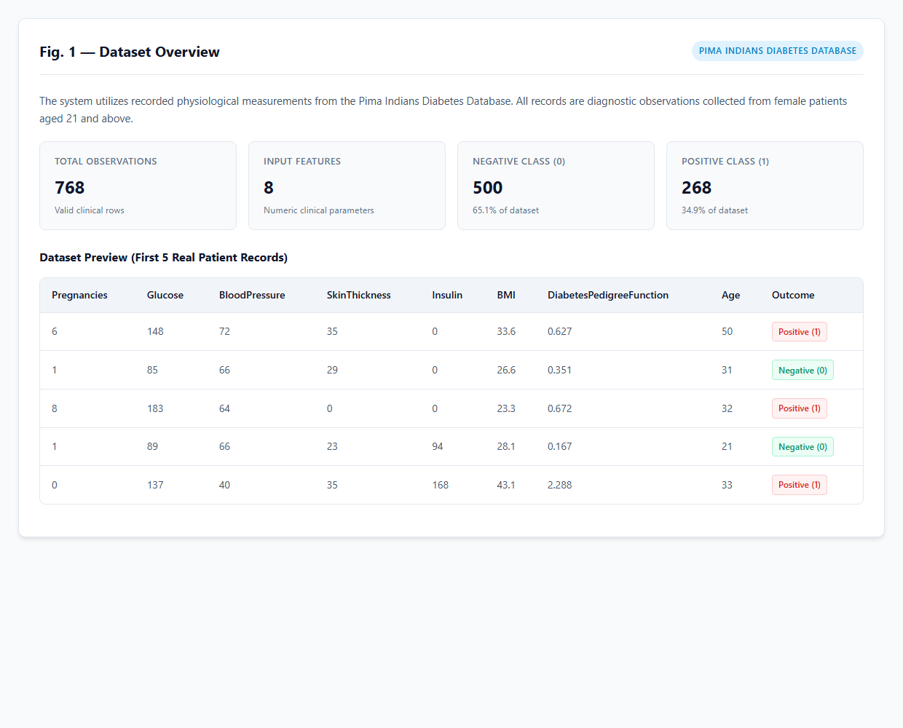
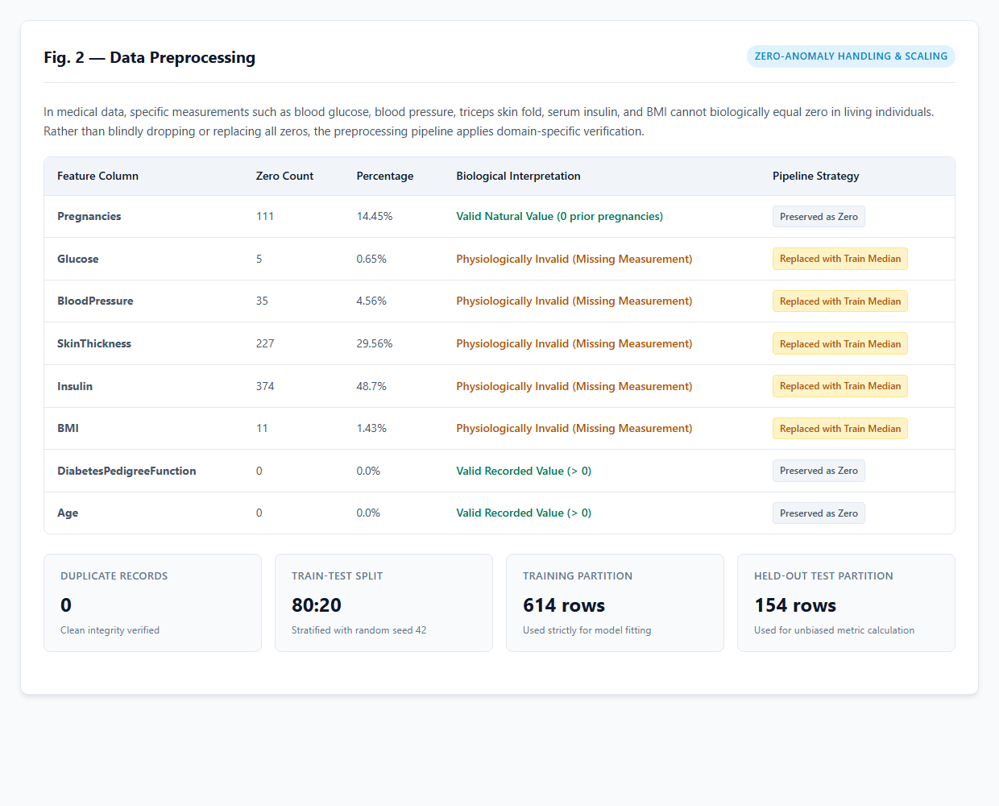
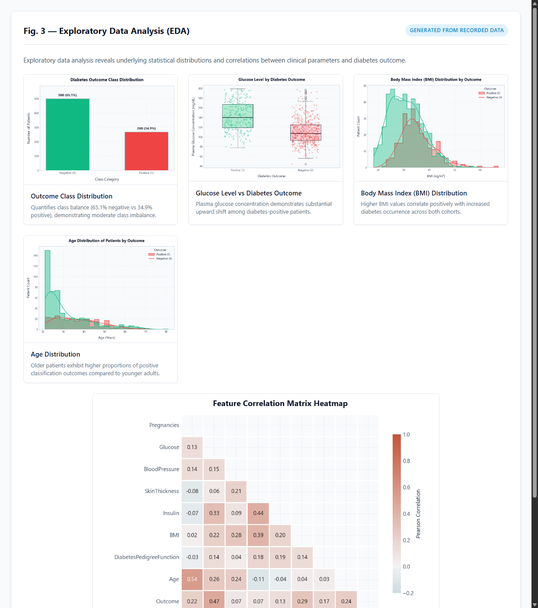
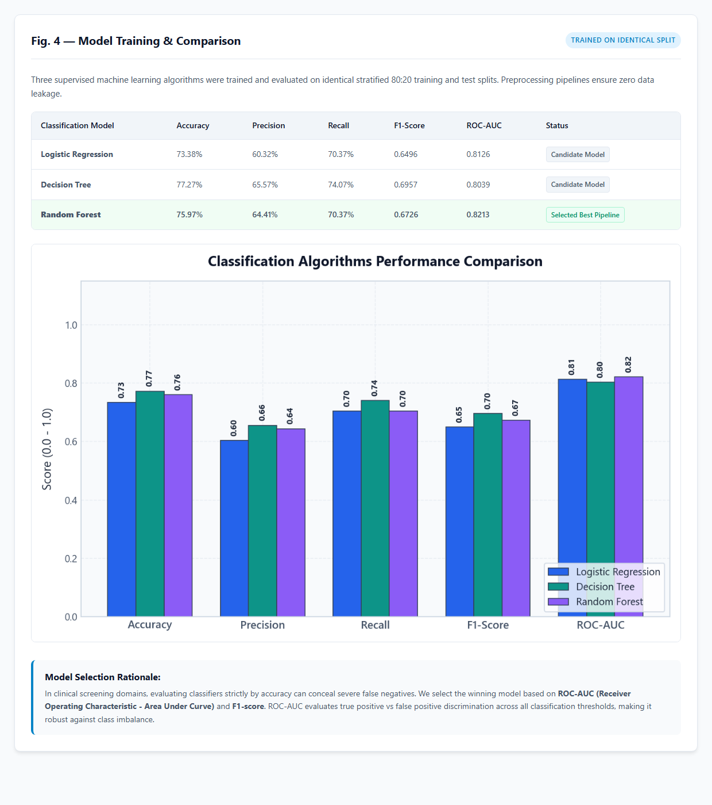
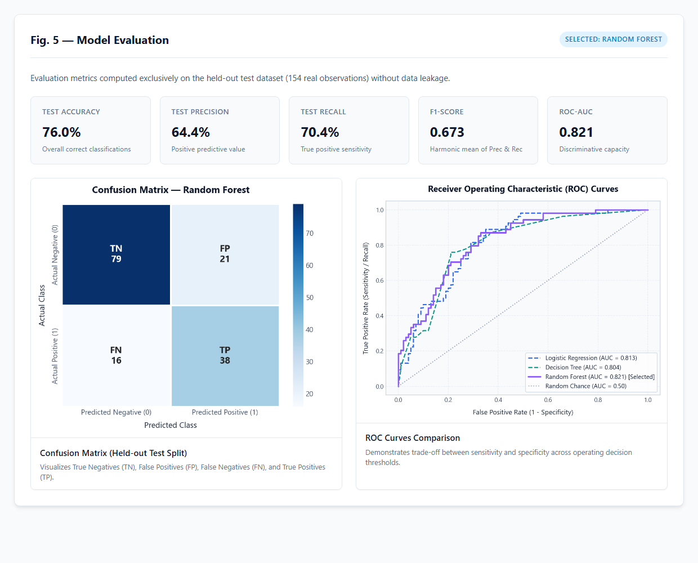
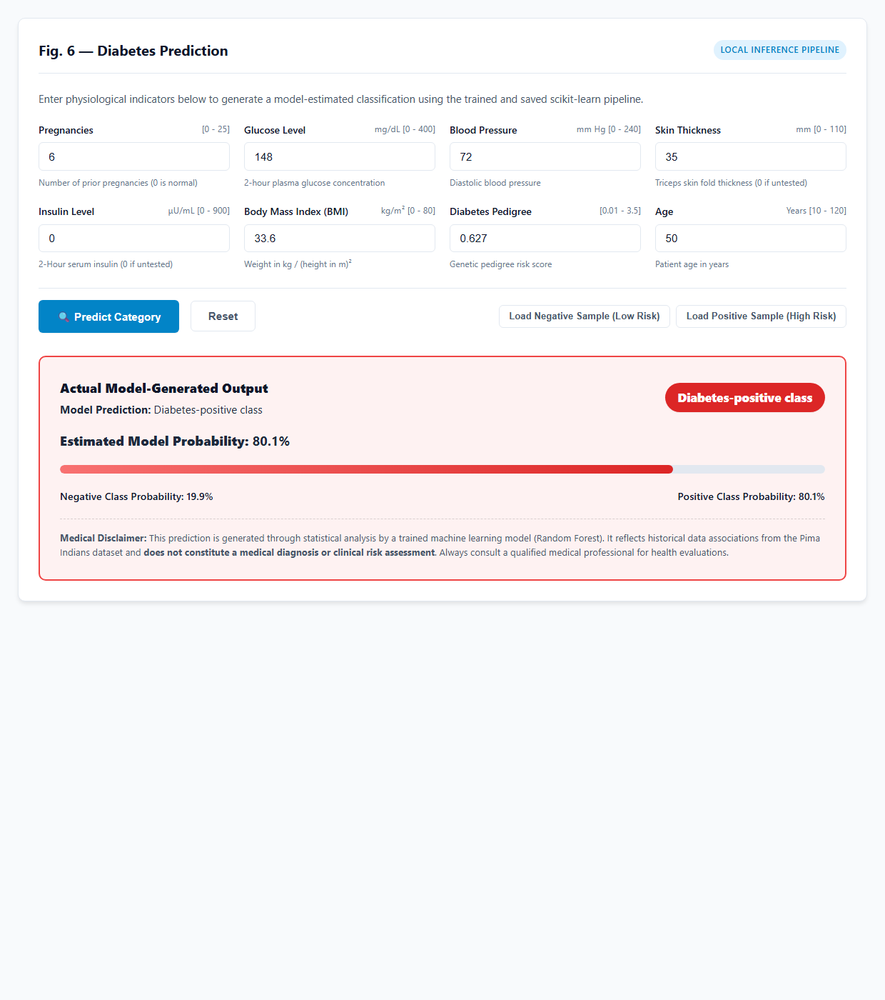

# Diabetes Prediction System Using Machine Learning

A complete, working machine learning mini-project and web application that estimates whether a person may fall into a **diabetes-positive** or **diabetes-negative** category based on diagnostic health indicators.

> **⚠️ ACADEMIC & EDUCATIONAL USE DISCLAIMER:**  
> This system is developed strictly for **educational and machine learning demonstration purposes only**. It must **not** be presented, marketed, or utilized as a certified medical diagnostic tool or clinical decision system. Model probabilities reflect statistical patterns learned from historical data and do not represent a person's true medical diagnosis or clinical risk. Always consult licensed medical professionals for health assessments.

---

## 1. Project Overview & Architecture

The **Diabetes Prediction System** implements the complete, end-to-end Machine Learning lifecycle locally without cloud dependencies, external APIs, or mock data:

```text
DiabetesPredictionSystem/
├── app.py                     # Flask web server and prediction routes
├── train_model.py             # ML pipeline, preprocessing, model training & plot generation
├── generate_screenshots.py    # Automated script capturing Figs 1-6
├── requirements.txt           # Python dependencies
├── README.md                  # Project documentation & execution guide
├── data/
│   └── diabetes.csv           # Pima Indians Diabetes Database (768 records)
├── models/
│   ├── diabetes_model.pkl     # Exported scikit-learn best pipeline (Joblib)
│   └── model_metadata.json    # Verified dataset stats & test evaluation metrics
├── static/
│   ├── style.css              # Modern light-themed CSS styles
│   ├── plots/                 # Real generated EDA and evaluation charts
│   │   ├── outcome_distribution.png
│   │   ├── glucose_vs_outcome.png
│   │   ├── bmi_distribution.png
│   │   ├── age_distribution.png
│   │   ├── correlation_heatmap.png
│   │   ├── model_comparison.png
│   │   ├── confusion_matrix.png
│   │   └── roc_curve.png
│   └── screenshots/           # Demonstration figures for project presentation
│       ├── fig1_dataset_overview.png
│       ├── fig2_data_preprocessing.png
│       ├── fig3_eda_visualizations.png
│       ├── fig4_model_training.png
│       ├── fig5_model_evaluation.png
│       └── fig6_diabetes_prediction.png
└── templates/
    └── index.html             # Responsive light-themed web interface
```

---

## 2. Technologies Used

- **Python 3.10+**: Core programming language
- **Flask**: Lightweight local WSGI web server
- **Pandas**: Tabular data manipulation and summary analytics
- **NumPy**: Numerical transformations and vector operations
- **Scikit-learn**: Preprocessing pipelines, classification algorithms, and test metric calculation
- **Matplotlib & Seaborn**: High-resolution, publication-standard data visualizations
- **Joblib**: Serialized pipeline persistence (`.pkl`)
- **HTML5 & CSS3**: Modern, clean, responsive, light-themed web user interface

---

## 3. Dataset Information

The system utilizes the standard **Pima Indians Diabetes Database** (`data/diabetes.csv`), comprising 768 diagnostic records collected from female patients aged 21 and older.

### Feature Dictionary:

| Feature Name | Clinical Meaning | Realistic Unit | Zero Value Interpretation |
| :--- | :--- | :--- | :--- |
| **Pregnancies** | Number of times pregnant | Count (0 - 25) | **Valid** (0 indicates no prior pregnancies) |
| **Glucose** | 2-hour plasma glucose concentration | mg/dL (0 - 400) | **Invalid/Missing** (biologically impossible to be 0) |
| **BloodPressure** | Diastolic blood pressure | mm Hg (0 - 240) | **Invalid/Missing** (cannot be 0 in a living patient) |
| **SkinThickness** | Triceps skin fold thickness | mm (0 - 110) | **Invalid/Missing** (unmeasured test value) |
| **Insulin** | 2-Hour serum insulin | μU/mL (0 - 900) | **Invalid/Missing** (unmeasured test value) |
| **BMI** | Body mass index (weight / height²) | kg/m² (0 - 80) | **Invalid/Missing** (biologically impossible to be 0) |
| **DiabetesPedigreeFunction** | Genetic pedigree risk score | Score (0.01 - 3.5) | **Valid** (always > 0) |
| **Age** | Patient age | Years (10 - 120) | **Valid** (always > 0) |
| **Outcome** | Target class label | 0 or 1 | **0 = Negative class**, **1 = Positive class** |

### How to Obtain the Dataset:

The dataset is already included in `data/diabetes.csv`. If you ever need to re-download it from the official source, run:

```bash
python -c "import urllib.request; urllib.request.urlretrieve('https://raw.githubusercontent.com/plotly/datasets/master/diabetes.csv', 'data/diabetes.csv')"
```

---

## 4. Machine Learning Workflow

The project follows the formal 9-step machine learning workflow:

1. **Problem Definition:** Binary classification task to estimate diabetes-positive or diabetes-negative risk categories.
2. **Data Collection:** Loading 768 authentic diagnostic records into Pandas.
3. **Data Preprocessing:**
   - **Zero-Value Anomaly Handling:** Features with physiologically impossible zeros (`Glucose`, `BloodPressure`, `SkinThickness`, `Insulin`, `BMI`) are handled via `SimpleImputer(missing_values=0, strategy='median')` fitted strictly on training data.
   - **Preservation of Valid Zeros:** Columns like `Pregnancies` where zero is a natural, normal state are preserved without alteration.
   - **Feature Scaling:** `StandardScaler` ensures features are scaled to zero mean and unit variance.
   - **Pipeline Integrity:** Assembled in a Scikit-Learn `ColumnTransformer` inside an end-to-end `Pipeline` to eliminate data leakage.
4. **Exploratory Data Analysis (EDA):** Generating real data visualizations (Outcome distribution, Glucose vs Outcome, BMI distribution, Age distribution, Pearson correlation heatmap).
5. **Feature Selection:** Utilizing all 8 clinical parameters verified by physiological relevance and correlation analysis.
6. **Train-Test Split:** 80% Training split (614 records) and 20% Held-out Test split (154 records) with stratification on `Outcome` and a fixed random seed (`random_state=42`).
7. **Model Training:** Training 3 benchmark classification algorithms:
   - Logistic Regression
   - Decision Tree Classifier
   - Random Forest Classifier
8. **Model Evaluation:** Computing real held-out test metrics (Accuracy, Precision, Recall, F1-Score, ROC-AUC, and Confusion Matrix).
9. **Model Selection & Export:** Persisting the top-performing pipeline with Joblib to `models/diabetes_model.pkl` and metadata to `models/model_metadata.json`.

### Model Selection Criterion:

> **Why ROC-AUC & F1-Score?**  
> In medical and healthcare risk categorization, raw accuracy is frequently misleading because the majority class (65.1% negative) dominates. A false negative (classifying a high-risk individual as negative) has severe clinical implications. Therefore, the pipeline prioritizes **ROC-AUC (Area Under the Receiver Operating Characteristic Curve)** and **F1-Score (harmonic mean of Precision and Recall)** to ensure balanced discriminative capability across decision thresholds.

---

## 5. Model Comparison & Test Set Results

All models were evaluated on the **exact same held-out test split (154 patient records)**:

| Classification Model | Test Accuracy | Test Precision | Test Recall (Sensitivity) | Test F1-Score | Test ROC-AUC | Status |
| :--- | :---: | :---: | :---: | :---: | :---: | :--- |
| **Logistic Regression** | 73.38% | 60.32% | 70.37% | 0.6496 | 0.8126 | Candidate Model |
| **Decision Tree** | 77.27% | 65.57% | 74.07% | 0.6957 | 0.8039 | Candidate Model |
| **Random Forest** | **75.97%** | **64.41%** | **70.37%** | **0.6726** | **0.8213** | **Selected Best Pipeline** |

*Selected Model:* **Random Forest Classifier** achieving the highest ROC-AUC of **0.8213** and robust recall.

---

## 6. Demonstration Screenshots

The project features a clean, light-themed responsive interface. Below are the 6 required demonstration figures:

### Fig. 1 — Dataset Overview
Shows dataset preview (first 5 records), record count (768), input feature count (8), and class breakdown.


---

### Fig. 2 — Data Preprocessing
Shows missing/invalid zero analysis table, biological rationale, train-test split details (80:20, 614 train / 154 test), and scaling strategy.


---

### Fig. 3 — Exploratory Data Analysis
Displays real visualizations: Outcome distribution, Glucose vs Outcome, BMI distribution, Age distribution, and Pearson correlation heatmap.


---

### Fig. 4 — Model Training & Comparison
Displays comparative performance metrics table across Logistic Regression, Decision Tree, and Random Forest, comparative bar chart, and model selection rationale.


---

### Fig. 5 — Model Evaluation
Displays real held-out test metrics (Accuracy: 76.0%, Precision: 64.4%, Recall: 70.4%, F1: 0.673, ROC-AUC: 0.821), Confusion Matrix (TN=79, FP=21, FN=16, TP=38), and multi-model ROC curves.


---

### Fig. 6 — Diabetes Prediction
Displays the interactive prediction form with entered values, the real model-generated prediction (`Diabetes-positive class`), estimated probability (`80.1%`), progress indicator, and medical disclaimer.


---

## 7. Installation & Execution Guide

### Step 1: Clone or Navigate to the Project Directory

```bash
cd "Diabetes Prediction System"
```

### Step 2: Create and Activate a Virtual Environment (Recommended)

On Windows (PowerShell):
```powershell
python -m venv venv
.\venv\Scripts\Activate.ps1
```

On Linux/macOS:
```bash
python3 -m venv venv
source venv/bin/activate
```

### Step 3: Install Required Dependencies

```bash
pip install -r requirements.txt
```

### Step 4: Train the Models and Generate Visualizations

Run the ML pipeline script:

```bash
python train_model.py
```

This will:
1. Load `data/diabetes.csv`.
2. Inspect invalid measurements and handle missing zeros.
3. Generate all 8 high-resolution charts in `static/plots/`.
4. Train Logistic Regression, Decision Tree, and Random Forest.
5. Evaluate models on the held-out test split.
6. Export the selected best pipeline to `models/diabetes_model.pkl`.
7. Save verification metadata to `models/model_metadata.json`.

### Step 5: Launch the Flask Web Application

```bash
python app.py
```

### Step 6: Access the Web Application

Open your browser and navigate to:

```text
http://127.0.0.1:5000
```

---

## 8. Prediction Testing Instructions

The web form includes convenient sample pre-fill buttons for quick testing:

### Test Case A: Low Risk (Diabetes-Negative)
Click **Load Negative Sample (Low Risk)**:
- Pregnancies: `1`
- Glucose Level: `85` mg/dL
- Blood Pressure: `66` mm Hg
- Skin Thickness: `29` mm
- Insulin Level: `0` μU/mL *(pipeline imputes training median)*
- BMI: `26.6` kg/m²
- Diabetes Pedigree: `0.351`
- Age: `31` years
- **Expected Output:** `Diabetes-negative class` (Estimated Probability ~10%)

### Test Case B: High Risk (Diabetes-Positive)
Click **Load Positive Sample (High Risk)**:
- Pregnancies: `6`
- Glucose Level: `148` mg/dL
- Blood Pressure: `72` mm Hg
- Skin Thickness: `35` mm
- Insulin Level: `0` μU/mL *(pipeline imputes training median)*
- BMI: `33.6` kg/m²
- Diabetes Pedigree: `0.627`
- Age: `50` years
- **Expected Output:** `Diabetes-positive class` (Estimated Probability ~80%)

---

## 9. Verification Checklist

- [x] Dataset loaded from `data/diabetes.csv` (768 records, 9 columns).
- [x] Preprocessing handles invalid biological zeros in `Glucose`, `BloodPressure`, `SkinThickness`, `Insulin`, `BMI` while preserving valid zeros like `Pregnancies`.
- [x] All 8 EDA and evaluation charts generated from real data and saved to `static/plots/`.
- [x] 3 classification algorithms trained on identical stratified 80:20 split (`random_state=42`).
- [x] Unbiased evaluation metrics calculated strictly on held-out test data.
- [x] Best model chosen based on ROC-AUC and F1-score criteria.
- [x] Complete preprocessing + classification pipeline serialized via Joblib to `models/diabetes_model.pkl`.
- [x] Flask application starts and serves modern, light-themed web interface without cloud dependencies.
- [x] Form input validation enforces physiological bounds and handles missing or invalid types.
- [x] Real-time inference generates exact predicted class and probability.
- [x] Prominent educational disclaimer on the interface, prediction card, and documentation.
